# Lab 02 - U-Boot and booting Linux

## 1. Objectives and starting point

### Objectives

The purpose of this lab is to move on from simply having U-Boot installed to actually understanding and controlling the Linux boot process.

The main goals are hence to:

- manually load and boot the Linux kernel from U-Boot
- inspect how the kernel, Device Tree and kernel command line interact
- understand and modify U-Boot's compile-time configuration
- understand U-Boot environment variables and their persistence
- build a boot menu capable of selecting different boot methods
- configure Ethernet communication between the host and the Raspberry Pi
- transfer files using TFTP
- boot Linux with its root filesystem mounted through NFS
- create a reusable U-Boot environment script
- integrate this script into Buildroot so that it is automatically included in the generated SD card image

The important idea is that U-Boot becomes the component that decides **what to boot, where to load it from, where to place it in RAM, and which parameters to give to the Linux kernel**.

### Starting point from Lab1

At the end of Lab 01, Buildroot was already configured for the Raspberry Pi 4 and U-Boot had been inserted into the boot chain.

The boot process at the beginning of this lab was therefore approximately:

```text
Power-on
   |
   v
Raspberry Pi boot ROM / firmware
   |
   v
start4.elf
   |
   |  loads U-Boot instead of Linux directly
   v
u-boot.bin
   |
   |  loads the Linux kernel, Device Tree and provides boot arguments
   v
Linux kernel ("Image")
   |
   |  mounts the root filesystem
   v
Linux userspace / root filesystem
```
This distinction between the different stages is important.
The Raspberry Pi firmware performs the platform-specific early boot process. It also loads the Device Tree describing the hardware.

U-Boot is the bootloader used in this lab. Unlike the Raspberry Pi firmware's simple direct boot, U-Boot provides an interactive shell, environment variables, storage and network commands, and the possibility of selecting different boot strategies.

The Linux kernel is stored as a file called Image. Once loaded into RAM and started, it initializes the hardware described by the Device Tree and uses the kernel command line to determine important settings such as the console and root filesystem.

The root filesystem is separate from the kernel. It contains userspace programs, libraries, configuration files and the init process. During this lab, the same Linux kernel will eventually be able to use either the root filesystem stored on the SD card or one provided over the network using NFS.

At the beginning of the lab, the SD card therefore contained two important partitions:

```
SD card
├── Partition 1: FAT boot partition
│   ├── Raspberry Pi firmware
│   ├── Device Tree files
│   ├── u-boot.bin
│   └── Image
│
└── Partition 2: Linux ext filesystem
    └── root filesystem
```

The serial UART connection configured previously is used throughout this lab to interact with U-Boot and observe the Linux boot process.


### Initial U-Boot state
After powering the Raspberry Pi and interrupting the automatic boot process, U-Boot provides an interactive prompt:

!["/images/lab2-starting-uboot.png"]

This is the starting point for the rest of the lab. Instead of letting the system boot automatically, the next steps consist of manually inspecting the SD card, locating the kernel and Device Tree, constructing the kernel arguments, and reproducing the Linux boot process ourselves.

## 2. Configure U-Boot to boot Linux manually

### U-Boot version and interactive shell

The first objective was to confirm that the Raspberry Pi was really running the U-Boot version built during Lab 01 and that the UART connection allowed interaction with its command-line interface.

After interrupting the automatic boot process, the `version` command was used:

```text
version
```

The result was:

```text
U-Boot 2025.01
```

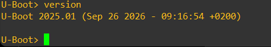

This confirms that the expected U-Boot binary is executing on the target.

The interactive U-Boot shell is important because it allows the boot process to be decomposed manually. Instead of treating booting as one opaque operation, U-Boot lets us separately inspect storage, load files into RAM, modify kernel arguments, inspect the Device Tree and finally start the kernel.

This distinction is useful for debugging: if Linux fails to boot, it becomes possible to determine whether the problem occurred while reading storage, loading the kernel, configuring its arguments, passing the Device Tree, or mounting the root filesystem.

### Inspecting the SD card

U-Boot accesses SD/eMMC devices through its MMC subsystem.

The available devices were first listed with:

```text
mmc list
```

The Raspberry Pi exposed two MMC controllers, and device `0` was identified as the physical SD card:

```text
mmcnr@7e300000: 1
mmc@7e340000: 0 (SD)
```

The SD card was selected with:

```text
mmc dev 0
```

and inspected with:

```text
mmc info
```

The card reported a capacity of approximately **29.7 GiB**.

The partition table was then displayed with:

```text
part list mmc 0
```

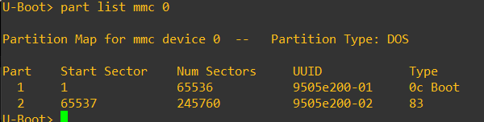

The SD card contains an MBR/DOS partition table with two partitions:

| Partition | Start sector | Number of sectors | Type | Purpose |
| --- | ---: | ---: | --- | --- |
| `mmc 0:1` | 1 | 65536 | `0x0c` | FAT boot partition |
| `mmc 0:2` | 65537 | 245760 | `0x83` | Linux root filesystem |

The SD card itself is much larger than these partitions because the Buildroot image defines fixed-size filesystems. Flashing the image reproduces those filesystem sizes; it does not automatically expand them to occupy the entire physical SD card.

This is an important distinction:

- the **physical SD card** has a capacity of about 29.7 GiB;
- the **Buildroot image** only defines a roughly 32 MiB boot partition and a roughly 120 MiB root filesystem;
- the remaining card space is therefore unused.

### Filesystems and kernel location

The filesystem type of each partition was checked with:

```text
fstype mmc 0:1
fstype mmc 0:2
```

The result was:

```text
mmc 0:1 -> FAT
mmc 0:2 -> ext4
```

The contents were then inspected with:

```text
fatls mmc 0:1 /
ext4ls mmc 0:2 /
```

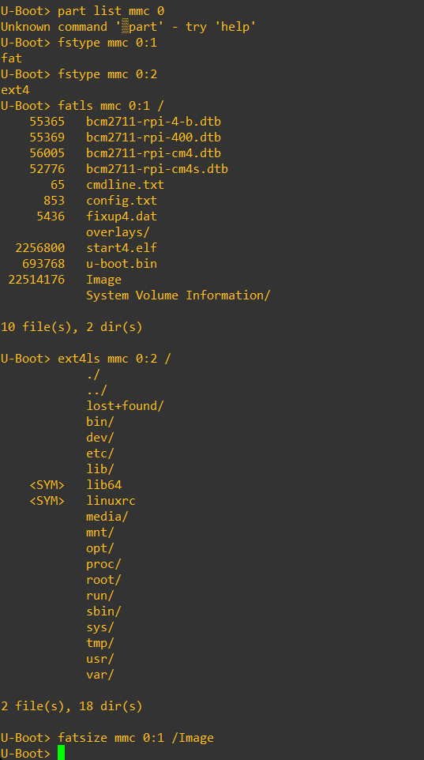

The first partition contains files required during the boot process, including:

- Raspberry Pi firmware files such as `start4.elf`;
- Device Tree files such as `bcm2711-rpi-4-b.dtb`;
- `u-boot.bin`;
- the Linux kernel image `Image`.

The second partition contains the Linux root filesystem, with directories such as:

```text
/bin
/dev
/etc
/lib
/proc
/sbin
/sys
/usr
/var
```

This demonstrates an important Linux concept: **the kernel and the root filesystem are separate objects**.

The kernel is a single executable image loaded into RAM before Linux starts. The root filesystem contains the userspace environment that Linux mounts later as `/`.

The exact kernel file is therefore:

```text
Device:      mmc 0
Partition:   1
Filesystem:  FAT
Filename:    Image
```

Its size was obtained using:

```text
fatsize mmc 0:1 /Image
printenv filesize
```

which returned:

```text
filesize=1578a00
```

U-Boot represents many numerical values in hexadecimal. `0x1578a00` corresponds to **22,514,176 bytes**, approximately **21.5 MiB**.

### Inspecting the Device Tree

The Raspberry Pi firmware loads the Device Tree before U-Boot starts. U-Boot exposes the address of this Device Tree Blob through the environment variable `fdt_addr`.

The address was inspected with:

```text
printenv fdt_addr
```

which returned:

```text
fdt_addr=2eff2300
```

The FDT commands were then pointed at this address:

```text
fdt addr ${fdt_addr}
```

and the `/chosen` node was displayed with:

```text
fdt print /chosen
```

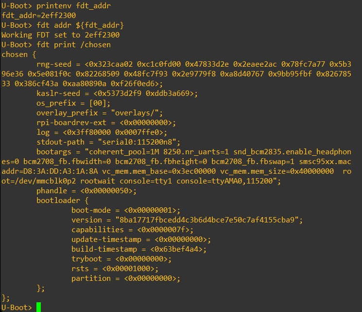

The `/chosen` node is particularly interesting because it contains information intended for the operating system, including the kernel command line stored in the `bootargs` property.

Among the existing arguments were:

```text
root=/dev/mmcblk0p2
rootwait
console=tty1
console=ttyAMA0,115200
```

Only these arguments were required for the manual boot performed in this part of the lab.

### Understanding the kernel arguments

The U-Boot environment variable conventionally used to pass the kernel command line is `bootargs`.

It was configured with:

```text
setenv bootargs 'root=/dev/mmcblk0p2 rootwait console=tty1 console=ttyAMA0,115200'
```

The resulting command line contains four important pieces of information.

#### `root=/dev/mmcblk0p2`

This tells Linux which block device contains its root filesystem.

The name can be decomposed as:

```text
mmcblk0   -> first MMC/SD block device
p2        -> partition 2
```

Therefore Linux will mount the second SD-card partition as `/`.

#### `rootwait`

The kernel may reach the root-filesystem mounting stage before the SD controller has completely initialized. `rootwait` tells Linux to wait until the root block device becomes available instead of immediately failing.

#### `console=tty1`

This enables a Linux console on the first virtual terminal, normally associated with the local display.

#### `console=ttyAMA0,115200`

This enables the serial console on the Raspberry Pi UART at 115200 baud.

Having the serial console is particularly useful in embedded development because kernel messages and the login prompt remain accessible even without a monitor or graphical environment.

### Loading the Linux kernel into RAM

Finding `Image` on the SD card is not enough to execute it. U-Boot must first copy the kernel from persistent storage into DRAM.

The Raspberry Pi U-Boot configuration provides the variable:

```text
kernel_addr_r=0x00080000
```

This variable identifies a RAM address intended for loading the kernel.

The kernel was loaded with:

```text
fatload mmc 0:1 ${kernel_addr_r} Image
```

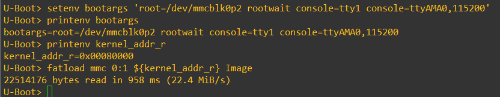

The command can be read as:

```text
fatload
    mmc             storage interface
    0:1             MMC device 0, partition 1
    ${kernel_addr_r} destination address in RAM
    Image           source filename
```

U-Boot reported:

```text
22514176 bytes read
```

This matches the kernel size found earlier, confirming that the entire `Image` file was copied from the FAT partition into RAM.

An important point for the oral exam is that `kernel_addr_r` does **not** describe where the kernel is stored on the SD card.

It describes where U-Boot should place the kernel **in RAM** before execution.

### Starting the kernel with `booti`

The ARM64 Linux kernel was finally started with:

```text
booti ${kernel_addr_r} - ${fdt_addr}
```

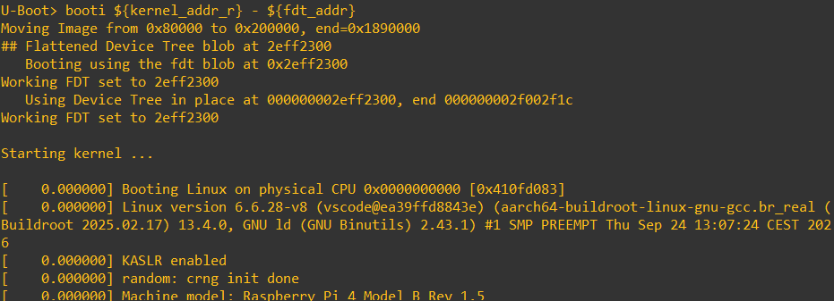

The three arguments have distinct purposes:

```text
${kernel_addr_r}   -> address of the Linux kernel in RAM
-                  -> no initial RAM disk (initrd) is used
${fdt_addr}        -> address of the Device Tree Blob
```

`booti` is the U-Boot command used to boot a Linux kernel stored in the ARM64 `Image` format.

During execution, U-Boot reported that it moved the image from `0x80000` to another suitable location before starting it. This relocation is handled internally by U-Boot and does not change the meaning of `kernel_addr_r`: that variable still specifies the address where the image is initially loaded.

The kernel then started successfully and eventually reached the configured Linux login prompt.

### What this manual boot demonstrated

By manually reproducing the boot sequence, the relationship between the major components became clearer:

```text
SD FAT partition
      |
      | fatload
      v
Linux Image in DRAM
      |
      | booti
      |
      +---- bootargs
      |
      +---- Device Tree at fdt_addr
      |
      v
Linux kernel
      |
      | root=/dev/mmcblk0p2
      v
ext4 root filesystem on SD partition 2
      |
      v
Linux userspace
```

The key idea is that U-Boot does not itself provide the Linux userspace. Its role is to prepare the information and objects that the kernel needs, then transfer control to Linux.

For this manual SD boot, U-Boot provided:

- the kernel image in RAM;
- the kernel command line through `bootargs`;
- the Device Tree through `fdt_addr`.

Linux then took over, initialized the hardware and mounted the root filesystem itself.

### Oral-exam notes

`Image` is the Linux kernel file stored on the FAT partition. `kernel_addr_r` is a RAM address used to load that file before execution. These are two completely different concepts.

`bootargs` is a string passed by U-Boot to the Linux kernel. It controls kernel behaviour; it is not a set of commands executed by U-Boot.

The Device Tree describes the hardware to Linux. On this Raspberry Pi configuration, the firmware loads it before U-Boot and exposes its address through `fdt_addr`.

The command:

```text
booti ${kernel_addr_r} - ${fdt_addr}
```

therefore means: boot the ARM64 kernel loaded at `kernel_addr_r`, without an initrd, using the Device Tree located at `fdt_addr`.


## 3. Inspect and modify U-Boot configuration

After proving that the existing U-Boot could manually boot Linux, the next objective was to modify U-Boot itself.

This section is different from changing U-Boot environment variables at runtime. Here, the changes are made to U-Boot's **compile-time configuration**, so a new `u-boot.bin` must be built and flashed.

That distinction is important:

- **U-Boot configuration options** such as `CONFIG_CMD_PAUSE` determine which features are compiled into the U-Boot binary.
- **U-Boot environment variables** such as `bootdelay`, `bootcmd` or `serverip` are data used by U-Boot at runtime.

A runtime environment variable cannot enable a command that was never compiled into U-Boot.

### Inspecting the persistent U-Boot environment

U-Boot has an environment containing variables such as `bootargs`, `bootcmd`, network addresses and menu definitions.

Without persistent storage, modifications made with `setenv` exist only in RAM and disappear after a reset. U-Boot therefore needs a configured location where `saveenv` can store the environment.

The U-Boot configuration was opened from Buildroot with:

```sh
make uboot-menuconfig
```

Searching the configuration for the environment showed:

```text
CONFIG_ENV_SIZE=0x4000
CONFIG_ENV_IS_IN_FAT=y
CONFIG_ENV_FAT_INTERFACE="mmc"
CONFIG_ENV_FAT_DEVICE_AND_PART="0:1"
CONFIG_ENV_FAT_FILE="uboot.env"
```

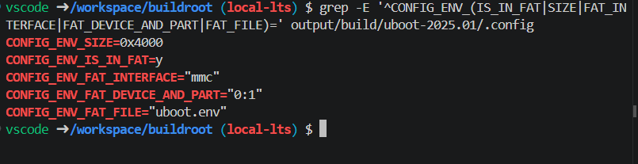

This describes the environment very precisely:

| Setting | Meaning |
| --- | --- |
| `CONFIG_ENV_IS_IN_FAT=y` | The persistent environment is stored as a file in a FAT filesystem |
| `CONFIG_ENV_FAT_INTERFACE="mmc"` | The storage device is accessed through the MMC subsystem |
| `CONFIG_ENV_FAT_DEVICE_AND_PART="0:1"` | MMC device 0, partition 1 |
| `CONFIG_ENV_FAT_FILE="uboot.env"` | Environment filename |
| `CONFIG_ENV_SIZE=0x4000` | Maximum environment size |

`0x4000` is hexadecimal for 16384 bytes, therefore the persistent environment has a size of **16 KiB**.

On this system, the persistent environment is therefore:

```text
SD card
└── MMC device 0
    └── Partition 1 (FAT)
        └── uboot.env
```

This also explains the message seen on a fresh image:

```text
Loading Environment from FAT... Unable to read "uboot.env" from mmc0:1...
```

That message does not mean U-Boot itself failed. It means no previously saved environment file exists yet, so U-Boot falls back to its compiled default environment.

After the first successful `saveenv`, the file is created and subsequent boots can load the saved runtime environment.

### Disabling the default autoboot

The stock configuration used:

```text
CONFIG_BOOTDELAY=2
```

This means U-Boot automatically executes its boot command after two seconds unless a key is pressed.

For the lab, the compiled default was changed to:

```text
CONFIG_BOOTDELAY=-1
```

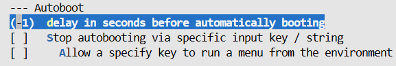

A value of `-1` disables automatic booting and leaves U-Boot at the command prompt indefinitely.

This is useful while developing because it guarantees enough time to inspect and modify the system after every reboot.

Later in the lab, a runtime environment variable `bootdelay=3` is deliberately used again. This is not contradictory:

- `CONFIG_BOOTDELAY=-1` defines the **compiled default**;
- the persistent environment can later override that default with `bootdelay=3`.

This illustrates an important U-Boot principle: **saved environment variables override many compiled default values at runtime**.

### Enabling the `pause` command

The boot menu requires some entries to display information and then wait for user input before continuing.

The `pause` command was not included in the original U-Boot configuration, so it was enabled through:

```text
CONFIG_CMD_PAUSE=y
```

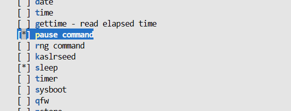

Once compiled, `pause` can stop command execution until the user presses a key.

This becomes useful for menu entries such as:

```text
U-Boot version -> version; pause
Board information -> bdinfo; pause
```

Without `pause`, the information would be displayed and the menu logic could continue immediately, making the output difficult to inspect.

### Enabling the boot menu

U-Boot supports an interactive terminal boot menu through the `bootmenu` command.

It was enabled with:

```text
CONFIG_CMD_BOOTMENU=y
```

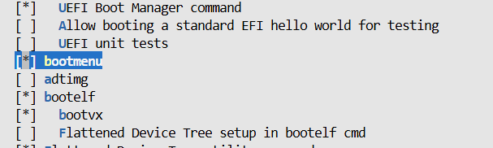

The menu entries themselves are not hard-coded by this option. Enabling `CONFIG_CMD_BOOTMENU` only makes the `bootmenu` command available.

The actual entries will later be created dynamically using environment variables such as:

```text
bootmenu_0
bootmenu_1
bootmenu_2
...
```

This separation is useful:

- the compiled binary provides the **bootmenu feature**;
- the runtime environment defines **what the menu contains**.

### Disabling EFI boot support

`CMD_BOOTEFI` was enabled in the initial configuration.

For this lab it was disabled:

```text
# CONFIG_CMD_BOOTEFI is not set
```

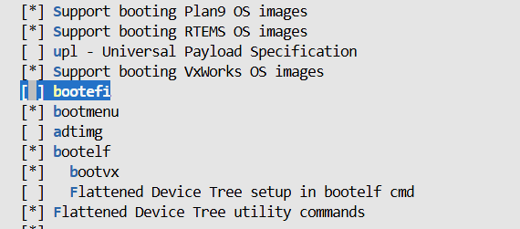

The reason is not that EFI is inherently incompatible with the Raspberry Pi.

In this specific setup, U-Boot's EFI boot manager could automatically contribute an unwanted `mmc 0` entry to the boot menu and attempt to locate an EFI `Boot0000` entry on the SD card.

The lab instead wants the boot menu to be fully controlled through our own environment variables, so disabling `CMD_BOOTEFI` avoids this implicit behaviour.

### Final U-Boot configuration changes

The resulting relevant U-Boot configuration was:

```text
CONFIG_BOOTDELAY=-1
CONFIG_CMD_PAUSE=y
CONFIG_CMD_BOOTMENU=y
# CONFIG_CMD_BOOTEFI is not set
```

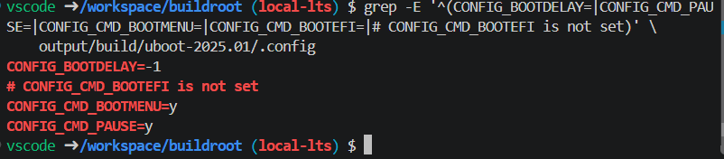

These changes affect the contents and default behaviour of the U-Boot binary itself, so rebuilding is required.

### Making the U-Boot configuration reproducible

Changing `output/build/uboot-2025.01/.config` manually is not sufficient for a reproducible Buildroot project.

The `output/` directory contains generated build state and can be deleted by commands such as:

```sh
make clean
```

Therefore, the U-Boot changes were saved in a configuration fragment under the board directory:

```text
board/raspberrypi/alexandre_rpi4_uboot.fragment
```

with the following contents:

```text
CONFIG_BOOTDELAY=-1
CONFIG_CMD_PAUSE=y
CONFIG_CMD_BOOTMENU=y
# CONFIG_CMD_BOOTEFI is not set
```

Buildroot was then configured to apply this fragment in addition to the standard Raspberry Pi 4 U-Boot defconfig:

```text
BR2_TARGET_UBOOT_CONFIG_FRAGMENT_FILES="board/raspberrypi/alexandre_rpi4_uboot.fragment"
```

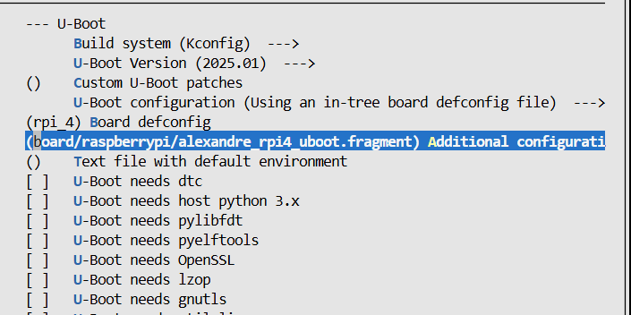

This is an important Buildroot concept.

The base U-Boot configuration still comes from:

```text
rpi_4_defconfig
```

while the fragment contains only the project-specific differences.

Conceptually, the resulting configuration is:

```text
rpi_4_defconfig
       +
alexandre_rpi4_uboot.fragment
       |
       v
final U-Boot .config
       |
       v
u-boot.bin
```

This is preferable to storing an entire generated `.config` because the fragment is small, understandable and easy to maintain.

### Rebuilding the image

After the configuration was made reproducible, U-Boot and the SD card image were rebuilt.

The final generated files included:

```text
output/images/u-boot.bin   ~680 KiB
output/images/boot.vfat     32 MiB
output/images/sdcard.img   153 MiB
```

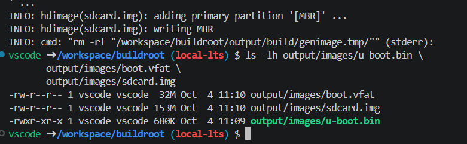

The new SD card image was then flashed to the Raspberry Pi.

The important point is that modifying a compile-time U-Boot option requires a new binary:

```text
U-Boot configuration
       |
       v
compile
       |
       v
u-boot.bin
       |
       v
new SD-card image
       |
       v
flash and reboot target
```

A simple `saveenv` could never perform this job because `saveenv` only stores runtime environment data; it does not rebuild the bootloader executable.

### Runtime validation of the rebuilt U-Boot

After flashing the rebuilt image, the newly compiled commands were checked directly on the Raspberry Pi.

The following commands were available:

```text
help pause
help bootmenu
```

while:

```text
help bootefi
```

returned:

```text
Unknown command 'bootefi'
```

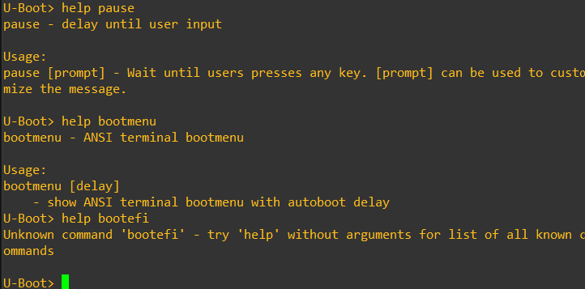

This verifies that the intended compile-time changes are actually present in the binary running on the hardware:

- `pause` is compiled in;
- `bootmenu` is compiled in;
- `bootefi` is no longer compiled in.

The target also remained at the U-Boot prompt instead of automatically booting Linux, confirming the new default `CONFIG_BOOTDELAY=-1`.

### Compile-time configuration vs runtime environment

This section introduces one of the most important distinctions in U-Boot:

| Compile-time configuration | Runtime environment |
| --- | --- |
| Decides which features exist in the binary | Controls how those features are used |
| Modified using Kconfig / `uboot-menuconfig` | Modified using commands such as `setenv` |
| Requires rebuilding `u-boot.bin` | Does not require recompiling |
| Examples: `CONFIG_CMD_PAUSE`, `CONFIG_CMD_BOOTMENU` | Examples: `bootcmd`, `bootdelay`, `serverip` |
| Defaults are compiled into U-Boot | Can be saved persistently using `saveenv` |

For example:

```text
CONFIG_CMD_BOOTMENU=y
```

makes the `bootmenu` command exist.

But:

```text
bootmenu_0=U-Boot version=version; pause
```

is a runtime environment variable that defines one menu entry.

Both are necessary for the final behaviour, but they operate at different levels.

### Oral-exam notes

The U-Boot environment is **not the same thing as the U-Boot configuration**.

The configuration determines the binary that gets compiled. The environment is runtime data interpreted by that binary.

On this target, the persistent environment is stored as:

```text
mmc 0:1 /uboot.env
```

on the FAT boot partition and has a configured size of **16 KiB**.

`setenv` modifies the current environment in RAM. `saveenv` serializes the environment to persistent storage.

A configuration fragment is used because the generated U-Boot `.config` under `output/build` is disposable. The fragment records only the project-specific changes and allows Buildroot to recreate the configuration after a clean build.

`CONFIG_BOOTDELAY=-1` disables autoboot as a compiled default, but a saved runtime variable such as `bootdelay=3` can later override that default.

## 4. Useful U-Boot memory addresses

U-Boot frequently needs to move data from persistent storage or from the network into DRAM before that data can be used.

For example:

- the Linux kernel is read from the SD card or received through TFTP, then placed in RAM;
- a Device Tree may already be present in RAM or may be loaded manually;
- an initrd can be loaded into RAM;
- a U-Boot script image must be loaded into RAM before the `source` command can execute it.

U-Boot therefore exposes several environment variables containing addresses that are intended for particular types of data.

The lab provided the following important variables:

| Variable | Typical value | Purpose |
| --- | ---: | --- |
| `fdt_addr` | `0x2eff2300` | Address of the Device Tree already loaded by the Raspberry Pi firmware |
| `fdt_addr_r` | `0x02600000` | Suggested RAM address for loading another Device Tree |
| `fdtcontroladdr` | board-dependent | Address of the Device Tree used internally by U-Boot itself |
| `fileaddr` | updated dynamically | Address used by the most recent successful file transfer |
| `loadaddr` | `0x01000000` | Generic default load/scratch address |
| `ramdisk_addr_r` | `0x02700000` | Suggested RAM address for an initrd / ramdisk |
| `scriptaddr` | `0x02400000` | Suggested RAM address for a U-Boot script image |
| `kernel_addr_r` | `0x00080000` | Suggested RAM address for the Linux kernel |

These values are not filenames or locations on the SD card. They are **addresses in the Raspberry Pi's DRAM**.

### Why different addresses are used

Several objects may need to exist in memory at the same time during boot.

For example, when booting Linux from the SD card, the system simultaneously needs:

```text
DRAM
├── Linux kernel
│   └── loaded initially at ${kernel_addr_r}
│
├── Device Tree
│   └── available at ${fdt_addr}
│
└── U-Boot itself and other internal data
```

If arbitrary addresses were chosen without considering the memory layout, one loaded object could overwrite another.

The predefined variables therefore provide conventional locations that are appropriate for their intended purpose.

The important rule is:

> use the address variable corresponding to the type of object being loaded instead of inventing an arbitrary address.

### `fdt_addr` and `fdt_addr_r`

These two variables have similar names but different meanings.

#### `fdt_addr`

`fdt_addr` points to the Device Tree that the Raspberry Pi firmware has already placed in memory before U-Boot starts.

During the manual Linux boot, the value observed was:

```text
fdt_addr=2eff2300
```

This is why the kernel could be started with:

```text
booti ${kernel_addr_r} - ${fdt_addr}
```

No additional Device Tree had to be loaded from the SD card.

#### `fdt_addr_r`

`fdt_addr_r` is a suggested address for a Device Tree that **U-Boot itself loads into RAM**.

For example, if a different `.dtb` file were explicitly loaded from storage, a command could conceptually use:

```text
fatload mmc 0:1 ${fdt_addr_r} some-board.dtb
```

The difference is therefore:

```text
fdt_addr
    -> points to an FDT that already exists in memory

fdt_addr_r
    -> suggested RAM destination when loading another FDT
```

### `fdtcontroladdr`

U-Boot itself also uses a Device Tree to describe and configure the hardware it manages.

The address of that internal control Device Tree is exposed as:

```text
fdtcontroladdr
```

This should not normally be confused with the Device Tree passed to Linux.

Conceptually:

```text
fdtcontroladdr
    -> Device Tree used by U-Boot

fdt_addr
    -> Device Tree passed to Linux on this Raspberry Pi setup
```

They can describe very similar hardware, but they serve different consumers.

### `kernel_addr_r`

`kernel_addr_r` is the recommended address for loading the Linux kernel into RAM.

On this Raspberry Pi configuration:

```text
kernel_addr_r=0x00080000
```

The manual SD-card boot therefore used:

```text
fatload mmc 0:1 ${kernel_addr_r} Image
```

Later, the exact same RAM destination could be reused when obtaining the kernel through TFTP:

```text
tftpboot ${kernel_addr_r} Image
```

This demonstrates a useful abstraction:

```text
Where the kernel comes from     Where the kernel goes
---------------------------     ---------------------
SD card FAT filesystem     ─┐
                           ├──> ${kernel_addr_r}
TFTP server               ─┘
```

The source mechanism changes, but the kernel still ends up at the RAM address from which U-Boot can boot it.

### `loadaddr` and `fileaddr`

`loadaddr` is a generic default load address:

```text
loadaddr=0x1000000
```

It is useful for temporary or generic data when no more specific address variable is appropriate.

This was used during the first TFTP test, where a small text file was downloaded into RAM.

`fileaddr` is different.

It is updated by U-Boot after a successful file-transfer command and indicates the address where the most recently transferred file was placed.

For example, after:

```text
tftpboot ${loadaddr} tftp-test.txt
```

U-Boot can expose:

```text
fileaddr=1000000
filesize=...
```

Therefore:

```text
loadaddr
    -> address chosen before loading

fileaddr
    -> address recorded by U-Boot after the transfer
```

`filesize` is similarly updated to contain the transferred file's size.

### `scriptaddr`

`scriptaddr` is the recommended memory location for loading a U-Boot script image:

```text
scriptaddr=0x02400000
```

Later in the lab, the environment script image is loaded with commands such as:

```text
tftpboot ${scriptaddr} alexandre_rpi4_env.scr
```

or:

```text
fatload mmc 0:1 ${scriptaddr} alexandre_rpi4_env.scr
```

and then executed with:

```text
source ${scriptaddr}
```

Again, the transfer mechanism can change while the RAM destination remains appropriate for the object being loaded.

### `ramdisk_addr_r`

`ramdisk_addr_r` is reserved for an initial RAM filesystem / initrd:

```text
ramdisk_addr_r=0x02700000
```

An initrd is a temporary filesystem stored in RAM and made available to the kernel during early boot.

This lab does not use one, which is why the `booti` command contains `-` as its second argument:

```text
booti ${kernel_addr_r} - ${fdt_addr}
```

The `-` explicitly means that no initrd is being supplied.

### Meaning of the `_r` suffix

Several U-Boot variables end in `_r`:

```text
kernel_addr_r
fdt_addr_r
ramdisk_addr_r
```

In this context, these are **relocation/load addresses in RAM** intended for the corresponding boot object.

They should be understood as recommended destinations used while preparing the boot process, not as permanent storage locations.

### Relationship between storage, network and RAM

One of the most important ideas from this lab is that boot objects usually follow this pattern:

```text
persistent storage / network
            |
            | load or transfer
            v
           RAM
            |
            | boot / parse / execute
            v
        consumer
```

Examples:

```text
SD card /Image
    -> fatload
    -> ${kernel_addr_r}
    -> booti
    -> Linux kernel

TFTP Image
    -> tftpboot
    -> ${kernel_addr_r}
    -> booti
    -> Linux kernel

SD card .scr
    -> fatload
    -> ${scriptaddr}
    -> source
    -> U-Boot command interpreter
```

This distinction between **where data is stored** and **where it is loaded in memory** is fundamental to understanding U-Boot.

### Oral-exam notes

An address such as `kernel_addr_r` is not a partition, filename or physical storage location. It is a DRAM address.

`fdt_addr` and `fdt_addr_r` are not interchangeable in meaning:

- `fdt_addr` points to the Device Tree already supplied by the Raspberry Pi firmware;
- `fdt_addr_r` is a suggested address for loading another Device Tree.

`loadaddr` is generic, while variables such as `kernel_addr_r`, `scriptaddr` and `ramdisk_addr_r` are intended for specific object types.

The same object can be obtained from different sources while still being loaded to the same RAM address. For example, both `fatload` and `tftpboot` can place the Linux kernel at `${kernel_addr_r}`.

The `-` in:

```text
booti ${kernel_addr_r} - ${fdt_addr}
```

means that no initrd is provided.


## 5. Runtime boot environment and boot menu

After rebuilding U-Boot with the required commands enabled, the next step was to configure its **runtime behaviour** through environment variables.

This is different from the previous section:

- compile-time configuration decides which commands and features exist in `u-boot.bin`;
- runtime environment variables decide how those commands are combined and executed.

The lab also required the menu logic to be reusable, especially because later the same Linux kernel would be booted with different root filesystems.

### Environment persistence

Commands such as:

```text
setenv name value
```

modify the current U-Boot environment in RAM.

Those modifications are immediately usable, but they are not automatically persistent across a reboot.

To store them in the configured persistent environment file (`uboot.env` on `mmc 0:1`), U-Boot provides:

```text
saveenv
```

The resulting model is:

```text
setenv
   |
   v
environment in RAM
   |
   | saveenv
   v
uboot.env on the FAT partition
   |
   | next reboot
   v
environment loaded back into RAM
```

This means it is useful to test new variables first and only call `saveenv` once their behaviour has been validated.

### Configuring the menu timing

The lab requires two different delays:

1. U-Boot waits **3 seconds before entering the menu**.
2. Once the menu appears, it must remain displayed indefinitely.

These are controlled separately.

The runtime boot delay was configured with:

```text
setenv bootdelay 3
```

The menu timeout was stored in its own variable:

```text
setenv bootmenu_timeout -1
```

The main boot command then became:

```text
setenv bootcmd 'bootmenu ${bootmenu_timeout}'
```

This design is useful because the menu timeout can later be changed in one line without editing the entire `bootcmd`.

For example:

```text
setenv bootmenu_timeout 17
```

would make the menu execute its selected/default behaviour after 17 seconds, while:

```text
setenv bootmenu_timeout -1
```

keeps the menu visible indefinitely.

The basic menu entries were created as:

```text
setenv bootmenu_0 'U-Boot version=version; pause'
setenv bootmenu_1 'Board information=bdinfo; pause'
setenv bootmenu_2 'Reset target=reset'
```

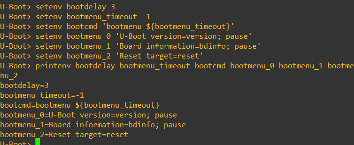

The menu variables use the syntax:

```text
bootmenu_<number>=Displayed label=command
```

For example:

```text
bootmenu_0=U-Boot version=version; pause
```

means:

```text
Displayed label:
    U-Boot version

Executed command:
    version; pause
```

The `pause` command is important because it prevents the output from disappearing immediately before the user has time to read it.

### Verifying the three-second autoboot delay

After the runtime value `bootdelay=3` was saved, rebooting showed the normal countdown:

```text
Hit any key to stop autoboot:  2
```

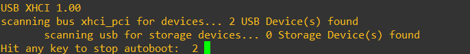

The countdown begins at 3, although the screenshot captured it at 2.

If a key is pressed during this countdown, U-Boot drops to its interactive prompt.

If no key is pressed, `bootcmd` runs and displays the boot menu.

This gives two useful behaviours:

```text
key pressed during 3 s
        |
        v
    U-Boot shell

no key pressed
        |
        v
bootcmd -> bootmenu
```

### Avoiding duplicated Linux boot logic

The lab explicitly asks the boot code to avoid unnecessary duplication because the root filesystem will later change.

Instead of writing one large independent command for every possible boot method, the Linux boot sequence was split into reusable pieces.

For SD-card boot, the following variables were introduced:

```text
console_args=console=tty1 console=ttyAMA0,115200

rootfs_sd=root=/dev/mmcblk0p2 rootwait

load_kernel_sd=fatload mmc 0:1 ${kernel_addr_r} Image
```

These variables describe three independent concerns:

```text
console_args
    -> where Linux should provide consoles

rootfs_sd
    -> where Linux should find its root filesystem

load_kernel_sd
    -> how U-Boot should obtain the kernel
```

This separation becomes particularly useful later, because the console configuration and the final `booti` command do not have to change when the root filesystem moves from the SD card to NFS.

### Constructing the SD-card boot path

The first modular design used:

```text
setenv boot_linux 'setenv bootargs ${rootfs_args} ${console_args}; booti ${kernel_addr_r} - ${fdt_addr}'

setenv boot_sd 'setenv rootfs_args ${rootfs_sd}; run load_kernel_sd; run boot_linux'
```

and the menu entry:

```text
setenv bootmenu_3 'Boot Linux from SD=run boot_sd'
```

The resulting menu now contained:

```text
U-Boot version
Board information
Reset target
Boot Linux from SD
Exit
```

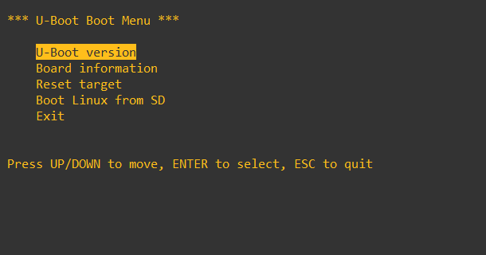

The idea behind `rootfs_args` was to introduce one temporary/common variable:

```text
rootfs_args
```

whose value depends on the selected boot method.

For SD boot:

```text
rootfs_args = rootfs_sd
```

Later, for network boot:

```text
rootfs_args = rootfs_nfs
```

Then the common code can build:

```text
bootargs = ${rootfs_args} ${console_args}
```

without duplicating the console settings.

### Troubleshooting the first modular boot attempt

The first implementation did not work as expected.

The kernel was successfully loaded from the FAT partition:

```text
22514176 bytes read
```

but `booti` failed with:

```text
ERROR: Did not find a cmdline Flattened Device Tree
Could not find a valid device tree
```

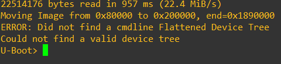

This error was initially surprising because the exact same Device Tree had already been used successfully during the earlier manual boot.

The following checks showed that the underlying data was still valid:

```text
printenv fdt_addr fdtcontroladdr kernel_addr_r
fdt addr ${fdt_addr}
fdt print /chosen
```

The Device Tree at `${fdt_addr}` could still be selected and inspected correctly.

The kernel load also succeeded independently.

Therefore the problem was not simply:

- a missing kernel;
- an invalid `${kernel_addr_r}`;
- a corrupted Device Tree;
- or an invalid `${fdt_addr}`.

The failure was associated with the way the compound `boot_linux` environment command combined setting `bootargs` and immediately invoking `booti`.

The exact internal parsing/expansion mechanism responsible for this behaviour was not conclusively isolated during the lab, so it is better not to claim a more specific cause than what was actually demonstrated.

### Splitting the common boot operations

The working solution was to separate the two common operations into their own environment variables:

```text
setenv set_bootargs 'setenv bootargs ${rootfs_args} ${console_args}'

setenv boot_kernel 'booti ${kernel_addr_r} - ${fdt_addr}'
```

The SD boot path then became:

```text
setenv boot_sd 'setenv rootfs_args ${rootfs_sd}; run set_bootargs; run load_kernel_sd; run boot_kernel'
```

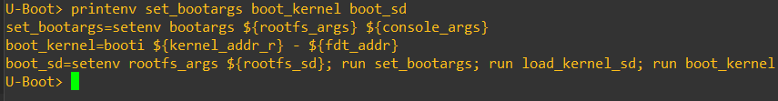

This structure is clearer as well as functional.

Conceptually:

```text
run boot_sd
    |
    +--> select SD root filesystem
    |       rootfs_args = rootfs_sd
    |
    +--> run set_bootargs
    |       bootargs = rootfs_args + console_args
    |
    +--> run load_kernel_sd
    |       FAT Image -> kernel_addr_r
    |
    +--> run boot_kernel
            booti kernel + FDT
```

Each variable now has one clear responsibility.

### Successful boot from the menu

With the corrected variables, selecting **Boot Linux from SD** successfully loaded and started Linux:

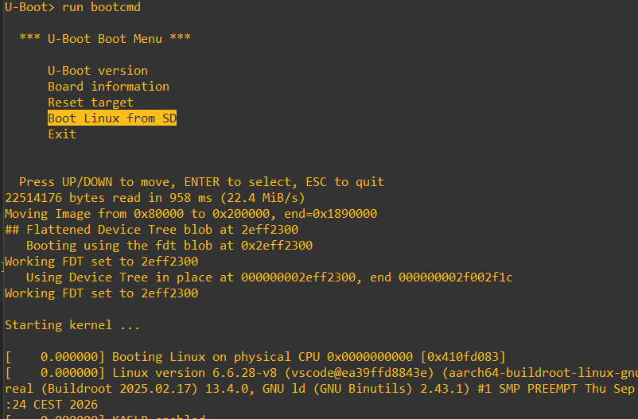

The output confirms the same steps that were previously performed manually:

```text
22514176 bytes read
```

followed by:

```text
Booting using the fdt blob at 0x2eff2300
```

and finally:

```text
Starting kernel ...
```

The major difference is that the procedure is now reusable through a single command:

```text
run boot_sd
```

or directly through the interactive boot menu.

Once this behaviour had been validated, the environment was persisted with:

```text
saveenv
```

### Why the modular structure matters

At this point, the SD boot code is separated into reusable layers:

```text
console_args
    common Linux console arguments

rootfs_sd
    SD-specific root filesystem arguments

load_kernel_sd
    SD-specific kernel-loading method

set_bootargs
    common command-line construction

boot_kernel
    common kernel execution

boot_sd
    SD-specific orchestration
```

This prepares the system for network boot.

Later, only new network-specific pieces are required:

```text
rootfs_nfs
load_kernel_tftp
boot_net
```

while:

```text
console_args
set_bootargs
boot_kernel
```

can be reused unchanged.

This is preferable to copying an entire long `booti` command into every menu entry because duplicated logic is harder to understand and maintain.

### Final boot-menu model at this stage

At the end of the SD boot-menu configuration, the runtime control flow was approximately:

```text
Power-on
   |
   v
U-Boot
   |
   | bootdelay=3
   |
   +---- key pressed ----> interactive U-Boot shell
   |
   +---- no key
            |
            v
     bootcmd
            |
            v
     bootmenu ${bootmenu_timeout}
            |
            +--> U-Boot version
            |
            +--> Board information
            |
            +--> Reset target
            |
            +--> Boot Linux from SD
```

The menu itself has no timeout because:

```text
bootmenu_timeout=-1
```

### Oral-exam notes

U-Boot environment variables are ordinary runtime data. `setenv` changes them in RAM and `saveenv` stores them persistently.

`bootdelay` controls how long U-Boot waits before executing `bootcmd`.

`bootcmd` is the command U-Boot executes after the autoboot delay. In this lab it is configured to launch `bootmenu`.

`bootmenu_timeout` is separate from `bootdelay`. One controls the delay **before entering the menu**, while the other controls behaviour **after the menu is displayed**.

A menu entry such as:

```text
bootmenu_3=Boot Linux from SD=run boot_sd
```

separates the displayed menu label from the command that is executed.

The modular variables are intentionally divided between:

- where the kernel comes from;
- where the root filesystem comes from;
- common console arguments;
- common kernel boot logic.

That separation makes it possible to add network boot later without duplicating the complete Linux boot sequence.

The failed first `boot_linux` implementation is also a useful debugging lesson: when a compound environment command fails, test each stage independently. Here, testing the kernel load and Device Tree separately showed that both were valid and narrowed the problem to the command composition itself.


## 6. Host-target networking

The next objective was to establish a direct Ethernet connection between the development host and the Raspberry Pi.

This network is used by U-Boot before Linux starts, so the configuration is independent of the network configuration that Linux may later use.

The lab requires the Raspberry Pi target to use:

```text
192.168.1.2
```

because the provided network-service setup expects that address.

The host was configured as:

```text
192.168.1.1/24
```

which places both machines in the same IPv4 subnet:

```text
192.168.1.0/24
```

Conceptually:

```text
Windows host                         Raspberry Pi / U-Boot
192.168.1.1            Ethernet      192.168.1.2
     |------------------------------------|
                  /24 network
```

No router or default gateway is required for communication between these two addresses because they are directly reachable on the same subnet.

### Configuring the host Ethernet interface

The computer was already using Wi-Fi for its normal network/Internet connection, so the physical Ethernet interface could be dedicated to the Raspberry Pi.

On Windows, the Ethernet interface was configured with a static address:

```powershell
netsh interface ipv4 set address name="Ethernet" static 192.168.1.1 255.255.255.0 none
```

This gives:

```text
Host address:   192.168.1.1
Netmask:        255.255.255.0
Gateway:        none
```

The dedicated network is therefore isolated from the normal Wi-Fi network and exists only for communication with the target.

### Configuring U-Boot networking

U-Boot stores its own network parameters in environment variables.

The target was configured with:

```text
setenv ipaddr 192.168.1.2
setenv serverip 192.168.1.1
setenv netmask 255.255.255.0
```

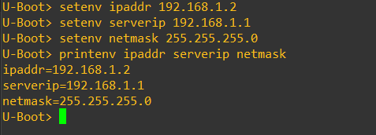

The variables have different roles:

| Variable | Meaning |
| --- | --- |
| `ipaddr` | IPv4 address of the target running U-Boot |
| `serverip` | Address of the host/server that U-Boot should contact |
| `netmask` | Subnet mask used to determine whether an address is local |

With these values:

```text
ipaddr   = 192.168.1.2
serverip = 192.168.1.1
netmask  = 255.255.255.0
```

U-Boot knows that the server is directly reachable on the same Ethernet network.

### Verifying the physical Ethernet link

The first ping attempt failed, so the Ethernet PHY was inspected before changing higher-level settings.

Commands such as:

```text
mii device
mii info
```

showed that U-Boot detected the Ethernet PHY and established a 100Base-T full-duplex link.

This was important because it separated two possible classes of failure:

```text
physical/link-layer problem
    cable, PHY, link negotiation

vs.

network/software problem
    IP configuration, firewall, service reachability
```

The physical link was working, so the investigation moved to the host side.

### Ping and Windows Firewall

The initial command:

```text
ping ${serverip}
```

did not receive a response even though the addresses were in the same subnet.

The cause was Windows Firewall blocking incoming ICMP echo requests on the dedicated Ethernet interface.

A narrow inbound firewall rule was created for ICMPv4 echo requests originating from the Raspberry Pi address.

After that, U-Boot reported:

```text
host 192.168.1.1 is alive
```

A new menu entry was then added:

```text
setenv bootmenu_4 'Ping server=ping ${serverip}; pause'
```

The final menu entry successfully pinged the host and paused before returning:

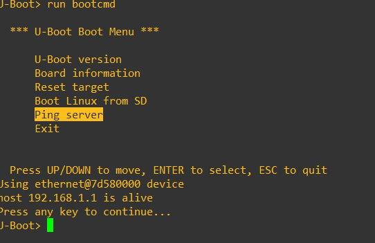

This verifies several layers at once:

```text
Raspberry Pi Ethernet PHY
        |
        v
U-Boot Ethernet driver
        |
        v
IPv4 configuration
        |
        v
Windows Ethernet interface
        |
        v
ICMP reply from 192.168.1.1
```

A successful ping does **not** prove that TFTP or NFS works, but it proves basic bidirectional IP connectivity between the host and target.

## TFTP file transfer

TFTP (Trivial File Transfer Protocol) is useful in bootloaders because it is much simpler than protocols such as HTTP, SMB or SSH.

U-Boot contains a TFTP client, while the development host provides the TFTP server.

The basic transfer direction in this lab is:

```text
Host TFTP server
       |
       | Ethernet / UDP
       v
U-Boot TFTP client
       |
       v
Raspberry Pi DRAM
```

The important point is that TFTP transfers a file **into RAM**. It does not automatically write the file to the SD card.

### Inspecting the provided TFTP service

The provided services container contained `tftpd-hpa`.

Its configuration was inspected with:

```sh
cat /etc/default/tftpd-hpa
```

The important values were:

```text
TFTP_USERNAME="tftp"
TFTP_DIRECTORY="/workspace/tftpd"
TFTP_ADDRESS=":69"
TFTP_OPTIONS="--secure"
```

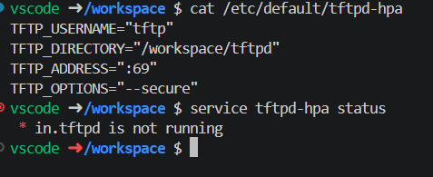

Therefore, the directory exported by the TFTP server was:

```text
/workspace/tftpd
```

and the service listened on the standard TFTP UDP port:

```text
69/UDP
```

The service could be controlled with:

```sh
sudo service tftpd-hpa start
sudo service tftpd-hpa status
```

A small test file was created containing:

```text
Hello from MA_SeS TFTP!
```

### TFTP problem with Docker Desktop on Windows

Although basic host-target ping worked, the provided container-based TFTP service could not be reached by U-Boot.

A transfer attempt:

```text
tftpboot ${loadaddr} tftp-test.txt
```

repeatedly timed out:

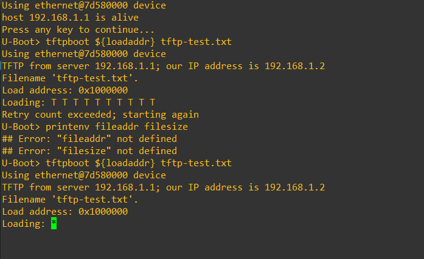

Several checks established that the TFTP daemon itself was functional:

- `in.tftpd` was listening on UDP port 69;
- the file existed and was readable;
- a TFTP request made locally inside the container succeeded;
- packet captures inside the container showed Docker-internal TFTP traffic.

However, while U-Boot attempted the transfer from `192.168.1.2`, a packet capture inside the service container showed **no corresponding packets arriving**.

The container network interfaces were on Docker Desktop's internal `192.168.65.x` network rather than directly on the physical `192.168.1.x` Ethernet network.

The practical path was therefore:

```text
U-Boot 192.168.1.2
        |
        | packets reached Windows host
        v
Windows Ethernet 192.168.1.1
        |
        X
provided service container
```

This was an important troubleshooting result: the problem was not the TFTP file, the U-Boot command or the TFTP daemon configuration. The requests from the physical target were not reaching the daemon inside the Docker Desktop networking environment.

This behaviour is specific to the host/container networking setup and should not be confused with a general limitation of TFTP.

### Windows-native TFTP workaround

To continue the lab, Tftpd64 was run directly on Windows.

It was configured with:

```text
Current directory:
C:\MSE\MA_SeS\tftpd

Server interface:
192.168.1.1
```

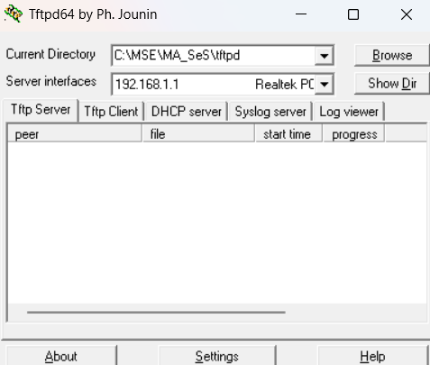

This removes the container-networking layer from the communication path:

```text
U-Boot 192.168.1.2
        |
        | Ethernet
        v
Tftpd64 on Windows 192.168.1.1
```

A local Windows TFTP test confirmed that the server could provide the file before testing again from the target.

### Successful TFTP transfer

From U-Boot, the test file was downloaded with:

```text
tftpboot ${loadaddr} tftp-test.txt
```

The transfer succeeded:

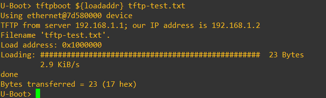

U-Boot reported:

```text
Load address: 0x1000000
Bytes transferred = 23 (17 hex)
```

The destination address came from:

```text
loadaddr=0x1000000
```

After a successful transfer, U-Boot also updated:

```text
fileaddr=1000000
filesize=17
```

Remember that U-Boot normally displays these numerical values in hexadecimal:

```text
0x17 = 23 decimal bytes
```

### Verifying the file in DRAM

A successful TFTP status message proves that bytes were transferred, but the lab also asks for the actual content to be verified in memory.

The transferred region was displayed with:

```text
md.b ${fileaddr} ${filesize}
```

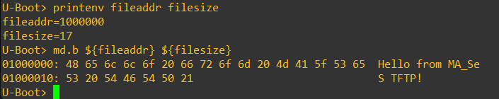

`md.b` means **memory display, byte-sized elements**.

The hexadecimal values in memory were:

```text
48 65 6c 6c 6f 20 66 72 6f 6d ...
```

which correspond to the ASCII text:

```text
Hello from MA_SeS TFTP!
```

This verifies the complete path:

```text
tftp-test.txt on host
        |
        | TFTP
        v
Ethernet network
        |
        v
U-Boot
        |
        | stored at ${loadaddr}
        v
Raspberry Pi DRAM
        |
        | md.b
        v
correct file contents
```

### `loadaddr`, `fileaddr` and `filesize`

This experiment also makes three U-Boot variables easier to distinguish.

Before the transfer:

```text
loadaddr
```

provides the generic destination address requested by the command.

After the successful transfer:

```text
fileaddr
```

contains the address where the most recent file was loaded, while:

```text
filesize
```

contains its size.

For this example:

```text
loadaddr = 0x1000000
fileaddr = 0x1000000
filesize = 0x17
```

The two addresses happen to match because `${loadaddr}` was explicitly supplied to `tftpboot`.

### Why TFTP is useful for embedded development

Without TFTP, testing a newly built kernel would normally require repeatedly:

```text
build kernel
    |
create/update SD image
    |
flash SD card
    |
boot target
```

With TFTP, the development cycle can instead become:

```text
build kernel on host
    |
place Image on TFTP server
    |
tftpboot Image directly into RAM
    |
boot kernel
```

This dramatically reduces the edit-build-test cycle because the SD card does not need to be reflashed for every kernel test.

The next section uses exactly this idea to load the full Linux kernel through TFTP.

### Oral-exam notes

`ipaddr` is the address of the U-Boot target. `serverip` is the address of the server U-Boot contacts.

A successful `ping` proves basic IPv4 reachability, but it does not prove that a specific application protocol such as TFTP is reachable.

TFTP transfers files into RAM. The destination must therefore be chosen just like any other U-Boot load operation.

`loadaddr` is a generic address selected before the transfer. `fileaddr` and `filesize` are updated after a successful transfer.

`md.b` displays memory one byte at a time and can be used to confirm that the received bytes really correspond to the expected file.

The TFTP failure encountered here was diagnosed by testing the layers separately:

1. Ethernet link was valid.
2. Ping to the Windows host worked.
3. The TFTP daemon worked locally inside its container.
4. U-Boot requests were not visible in the container packet capture.
5. Running the TFTP server directly on the physical Windows host solved the problem.

This is a good example of layered debugging: avoid changing the bootloader configuration blindly when the failure may be in the host networking path.


## 7. Kernel and root filesystem over the network

After validating basic Ethernet communication and TFTP with a small text file, the next objective was to boot Linux almost entirely from the development host.

The final arrangement is:

```text
SD card
├── Raspberry Pi firmware
├── U-Boot
└── Device Tree supplied by the firmware

Network
├── Linux kernel -> TFTP
└── Linux root filesystem -> NFS
```

This is described as an "almost fully" network-based boot because the Raspberry Pi still starts from the SD card and U-Boot itself is still stored there, but the two main Linux components are obtained from the host.

This section is useful because it clearly separates two different network mechanisms:

- **TFTP** is used once by U-Boot to copy the kernel file into RAM.
- **NFS** remains active after Linux starts and provides the live root filesystem mounted at `/`.

## Loading the Linux kernel through TFTP

The same `Image` file that had previously been loaded from the FAT partition was made available through the host TFTP server.

The important point is that the source changes, but the RAM destination does not.

The SD-card version used:

```text
fatload mmc 0:1 ${kernel_addr_r} Image
```

The network version used:

```text
tftpboot ${kernel_addr_r} Image
```

The kernel was successfully transferred to:

```text
kernel_addr_r=0x00080000
```

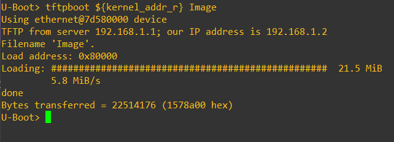

U-Boot reported:

```text
Bytes transferred = 22514176 (1578a00 hex)
```

This is the same size observed when the kernel was loaded from the SD card, confirming that the complete kernel image was received.

This demonstrates a useful abstraction:

```text
SD card FAT ── fatload ──┐
                         ├──> ${kernel_addr_r} ──> booti
TFTP server ─ tftpboot ──┘
```

Once the kernel is in RAM, `booti` does not care whether it came from an SD card or from the network.

## Generating a root filesystem archive with Buildroot

Until this point, the Linux root filesystem was stored inside the ext4 filesystem image on the SD card.

For NFS boot, the root filesystem instead needs to exist as a normal directory tree on the host.

One possibility would be to mount or extract the generated ext4 image, but this is inconvenient. Buildroot can directly generate a tar archive of the target root filesystem.

The Buildroot configuration originally explicitly disabled tar generation:

```text
# BR2_TARGET_ROOTFS_TAR is not set
```

The tar filesystem option defaults to enabled, so removing this explicit disabling line through the normal Buildroot configuration caused Buildroot to generate:

```text
output/images/rootfs.tar
```

This archive represents the same target filesystem contents that are also used to create the ext4 image.

The host-side NFS root directory was then populated with:

```sh
sudo find /workspace/nfs-rootfs -mindepth 1 -maxdepth 1 -exec rm -rf -- {} +

sudo tar --numeric-owner \
    -xf output/images/rootfs.tar \
    -C /workspace/nfs-rootfs
```

The `--numeric-owner` option is important when restoring a Linux root filesystem because ownership must be recreated using the numeric UID/GID values stored in the archive rather than being translated using host account names.

After extraction, `/workspace/nfs-rootfs` contained the expected root filesystem tree:

```text
bin/
dev/
etc/
lib/
linuxrc -> bin/busybox
proc/
root/
run/
sbin/
sys/
tmp/
usr/
var/
```

This directory then became the filesystem exported to the Raspberry Pi.

## NFS root filesystem concept

With a normal SD-card root filesystem, the kernel command line contains:

```text
root=/dev/mmcblk0p2
```

which tells Linux to mount a local block-device partition as `/`.

For NFS root, there is no local block device containing the root filesystem.

Instead, Linux must:

1. initialize the Ethernet interface;
2. configure its IP address;
3. contact the NFS server;
4. mount the exported directory as `/`;
5. start `/sbin/init` from that remote filesystem.

The root filesystem therefore remains on the host during the entire Linux runtime.

Conceptually:

```text
Linux kernel on Raspberry Pi
        |
        | NFS requests
        v
192.168.1.1:/rootfs
        |
        v
/workspace/nfs-rootfs on host
```

Any file accessed under `/` by the target is therefore being accessed over the network.

## Environment-specific NFS server problem

The lab provides a services container and expects the following services to be started:

```text
rpcbind
nfs-common
nfs-kernel-server
```

On the Docker Desktop environment used for this lab, however, `nfs-kernel-server` could not start and reported:

```text
Not starting NFS kernel daemon: no support in current kernel
```

This was an environment-specific problem caused by the Linux kernel used underneath Docker Desktop not providing the required kernel NFS-server support to the container.

This is different from the earlier TFTP issue:

```text
TFTP issue
    -> packets from the physical Ethernet interface did not reach
       the service container as expected

NFS issue
    -> the kernel NFS server itself could not run in the container
```

To continue the lab, a userspace NFS server, **NFS-Ganesha**, was used in a dedicated container.

It exported:

```text
/workspace/nfs-rootfs
```

through NFSv4/TCP on port:

```text
2049
```

and exposed it to the client using the NFSv4 path:

```text
/rootfs
```

The Windows host could reach the published NFS port on the physical Ethernet address:

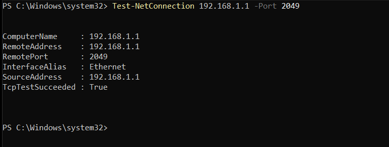

This confirms TCP reachability to the NFS service, although it does not by itself prove that the exported filesystem has correct permissions and ownership.

## NFSv4 UID/GID mapping problem

A local NFSv4 mount was used to validate the export before involving the Raspberry Pi.

The filesystem contents were visible and writable, but ownership was initially displayed as:

```text
4294967294:4294967294
```

instead of:

```text
0:0
```

for files that should belong to root.

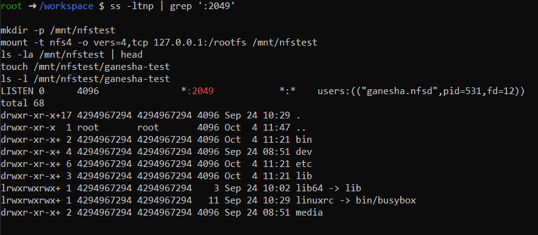

This became a serious problem when the Raspberry Pi attempted to boot from the NFS root.

Linux could mount the remote filesystem, but early userspace processes encountered errors such as:

```text
Permission denied
```

and some tasks became blocked in NFSv4 ID-mapping operations.

The important lesson is that successfully mounting an NFS filesystem is not sufficient for a usable NFS root filesystem.

A root filesystem also needs correct Unix ownership and permissions.

Files such as:

```text
/bin/busybox
/etc/
/run/
/dev/
```

must appear with the ownership expected by the target system.

## Preserving numeric ownership

The NFSv4 setup was adjusted so that numeric UID/GID ownership was preserved rather than relying on name-based NFSv4 identity mapping.

After the change, the local NFS test showed:

```text
0 0
```

for root-owned files, including `/bin/busybox`:

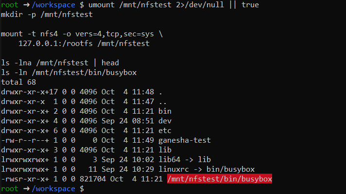

On the Linux client side, the NFS boot arguments also included:

```text
nfs.nfs4_disable_idmapping=Y
```

This forces the Linux NFSv4 client to use numeric ownership rather than attempting name-based UID/GID mapping.

This mattered in this setup because the embedded root filesystem and the NFS server do not share a normal centralized user-directory service.

For an embedded development root filesystem, preserving numeric IDs is usually the most direct representation of the ownership already generated by Buildroot.

## Kernel command line for NFS root

A new environment variable was created for the network root filesystem:

```text
rootfs_nfs=root=/dev/nfs rw nfsroot=192.168.1.1:/rootfs,vers=4,tcp,sec=sys ip=192.168.1.2:192.168.1.1::255.255.255.0::eth0:off nfs.nfs4_disable_idmapping=Y
```

This command line contains several independent pieces.

### `root=/dev/nfs`

This tells the kernel that the root filesystem is not a normal local block device and must be obtained through NFS.

### `rw`

The root filesystem should be mounted read/write.

This is useful during development because changes made by the target can be immediately reflected on the host filesystem.

### `nfsroot=192.168.1.1:/rootfs,vers=4,tcp,sec=sys`

This identifies the NFS root export.

It can be decomposed as:

```text
192.168.1.1
    NFS server address

/rootfs
    NFSv4 path exported by the server

vers=4
    use NFS version 4

tcp
    use TCP transport

sec=sys
    use traditional Unix UID/GID-based authentication
```

### `ip=192.168.1.2:192.168.1.1::255.255.255.0::eth0:off`

The root filesystem cannot be mounted until the kernel has working networking.

Therefore the kernel must configure Ethernet during early boot, before the normal userspace network scripts are available.

The fields used here provide:

```text
client IP:     192.168.1.2
server IP:     192.168.1.1
gateway:       empty
netmask:       255.255.255.0
hostname:      empty
interface:     eth0
autoconfig:    off
```

No gateway is required because both systems are directly connected in the same subnet.

### `nfs.nfs4_disable_idmapping=Y`

This disables the NFSv4 name-based ID-mapping mechanism on the Linux client and keeps ownership based on numeric UID/GID values.

## Reusing the modular boot structure

The modular environment designed earlier now becomes useful.

The SD-specific variables were:

```text
rootfs_sd
load_kernel_sd
boot_sd
```

The network equivalents were added as:

```text
rootfs_nfs
load_kernel_tftp
boot_net
```

with:

```text
load_kernel_tftp=tftpboot ${kernel_addr_r} Image
```

and:

```text
boot_net=setenv rootfs_args ${rootfs_nfs}; run set_bootargs; run load_kernel_tftp; run boot_kernel
```

Notice that these existing variables did not need to change:

```text
console_args
set_bootargs
boot_kernel
```

The design can therefore be viewed as:

```text
                    Linux boot
                        |
          +-------------+-------------+
          |                           |
        SD boot                   Network boot
          |                           |
rootfs_sd + load_kernel_sd   rootfs_nfs + load_kernel_tftp
          |                           |
          +-------------+-------------+
                        |
                shared commands
                        |
                 set_bootargs
                 boot_kernel
```

This is exactly why separating the boot process into reusable environment variables was useful.

## Adding the network boot menu entry

A final menu entry was created:

```text
setenv bootmenu_5 'Boot Linux from network=run boot_net'
```

The completed menu now contained:

```text
U-Boot version
Board information
Reset target
Boot Linux from SD
Ping server
Boot Linux from network
Exit
```

Selecting **Boot Linux from network** first downloaded the Linux kernel through TFTP and then started it with the NFS root arguments.

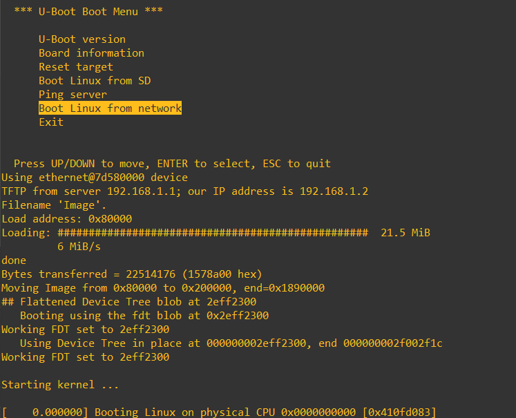

The screenshot shows the complete 21.5 MiB kernel being received through TFTP before `booti` starts Linux.

At that point:

```text
kernel
    -> came from TFTP

root filesystem
    -> came from NFS

Device Tree
    -> still came from the Raspberry Pi firmware / SD boot path
```

## Verifying that `/` really came from NFS

Reaching a login prompt is not sufficient proof that the NFS root is being used.

Once Linux had successfully booted, the root mount was checked with:

```sh
mount | grep ' on / '
```

The output showed:

```text
192.168.1.1:/rootfs on / type nfs4
```

This directly proves that `/` is an NFSv4 filesystem provided by the host.

The filesystem was also shown by:

```sh
df -h /
```

Finally, writability was verified with:

```sh
touch /nfs-write-test
ls -ln /nfs-write-test
```

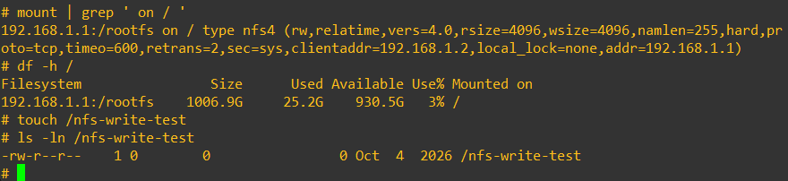

The resulting file was owned by:

```text
UID 0
GID 0
```

This provides three useful validations at once:

1. the root filesystem really is mounted through NFS;
2. the filesystem is writable;
3. numeric root ownership is preserved correctly.

## TFTP and NFS serve different purposes

Although both protocols are used over the same Ethernet connection, they solve very different problems.

| TFTP | NFS |
| --- | --- |
| Simple file transfer | Remote filesystem protocol |
| Used by U-Boot before Linux starts | Used by the Linux kernel and userspace |
| Transfers one complete file into RAM | Files are accessed on demand |
| Kernel `Image` is transferred once | Root filesystem stays remote |
| No normal filesystem semantics on target | Provides directories, permissions, ownership and read/write operations |

The final network boot uses both because each protocol matches a different requirement:

```text
TFTP
    good for quickly obtaining one boot image

NFS
    good for keeping a complete development root filesystem on the host
```

## Why NFS root is useful during development

With the root filesystem on the SD card, changing a target file often requires rebuilding and reflashing an image.

With NFS root:

```text
host filesystem
       |
       | immediately visible through NFS
       v
target /
```

This makes development much faster.

For example, binaries, scripts or configuration files can be updated in the exported host directory without rewriting the SD card.

It is therefore common for embedded development systems to use a network root filesystem during development even if the final deployed product eventually uses local flash storage.

## Oral-exam notes

TFTP and NFS are not interchangeable.

TFTP transfers the kernel as one file into RAM **before the kernel runs**.

NFS provides the root filesystem **while Linux is running**.

For NFS root, networking must be configured by the kernel itself before `/` can be mounted. This is why the `ip=` kernel argument is necessary even though normal Linux networking would usually be configured later from userspace.

`root=/dev/nfs` tells Linux that the root filesystem is network-based.

`nfsroot=` identifies the NFS server, exported path and mount options.

The root filesystem is not part of the kernel. This lab proves that clearly because the same Linux kernel can boot with:

```text
rootfs on SD
```

or:

```text
rootfs over NFS
```

without rebuilding the kernel.

A successful NFS mount is not sufficient for a root filesystem. Correct Unix permissions and UID/GID ownership must also be preserved so that `/sbin/init` and the rest of early userspace can run correctly.

The environment-specific NFSv4 ID-mapping failure was diagnosed by observing that root-owned files appeared with IDs `4294967294` instead of `0`. Once numeric ownership was preserved, the target booted normally and files created on `/` had UID/GID `0:0`.

## 8. U-Boot script

By this stage, the U-Boot environment had become fairly large.

It contained:

- menu timing;
- menu entries;
- network addresses;
- console arguments;
- SD-root arguments;
- NFS-root arguments;
- kernel loading commands;
- common boot commands;
- SD and network boot orchestration.

Entering all of those variables manually would be slow and error-prone, especially after resetting the environment or flashing a fresh SD card.

The goal of this section was therefore to convert the complete runtime configuration into a reusable **U-Boot script**.

## Creating a script of the environment

The script source was stored as:

```text
board/raspberrypi/alexandre_rpi4_env.cmd
```

Its contents were:

```text
setenv bootdelay 3
setenv bootmenu_timeout -1
setenv bootcmd 'bootmenu ${bootmenu_timeout}'

setenv bootmenu_0 'U-Boot version=version; pause'
setenv bootmenu_1 'Board information=bdinfo; pause'
setenv bootmenu_2 'Reset target=reset'
setenv bootmenu_3 'Boot Linux from SD=run boot_sd'
setenv bootmenu_4 'Ping server=ping ${serverip}; pause'
setenv bootmenu_5 'Boot Linux from network=run boot_net'

setenv ipaddr 192.168.1.2
setenv serverip 192.168.1.1
setenv netmask 255.255.255.0

setenv console_args 'console=tty1 console=ttyAMA0,115200'

setenv rootfs_sd 'root=/dev/mmcblk0p2 rootwait'
setenv rootfs_nfs 'root=/dev/nfs rw nfsroot=192.168.1.1:/rootfs,vers=4,tcp,sec=sys ip=192.168.1.2:192.168.1.1::255.255.255.0::eth0:off nfs.nfs4_disable_idmapping=Y'

setenv load_kernel_sd 'fatload mmc 0:1 ${kernel_addr_r} Image'
setenv load_kernel_tftp 'tftpboot ${kernel_addr_r} Image'

setenv set_bootargs 'setenv bootargs ${rootfs_args} ${console_args}'
setenv boot_kernel 'booti ${kernel_addr_r} - ${fdt_addr}'

setenv boot_sd 'setenv rootfs_args ${rootfs_sd}; run set_bootargs; run load_kernel_sd; run boot_kernel'
setenv boot_net 'setenv rootfs_args ${rootfs_nfs}; run set_bootargs; run load_kernel_tftp; run boot_kernel'

saveenv
```

The final `saveenv` is important.

Running the script does not only create the environment in RAM. It also stores the resulting environment persistently in:

```text
mmc 0:1 /uboot.env
```

This means that after the script has been executed once, the complete configuration survives a reboot.

## Plain script versus U-Boot script image

The `.cmd` file is ordinary text.

It contains commands that could also be typed manually at the U-Boot prompt.

However, the `source` command is designed to execute a **U-Boot script image**, not simply an arbitrary text file.

The source script therefore had to be converted using U-Boot's `mkimage` tool.

The conversion was initially performed with:

```sh
mkimage \
    -A arm64 \
    -O linux \
    -T script \
    -C none \
    -n "MA_SeS Lab2 U-Boot environment" \
    -d alexandre_rpi4_env.cmd \
    alexandre_rpi4_env.scr
```

The main options mean:

| Option | Meaning |
| --- | --- |
| `-A arm64` | Target architecture |
| `-O linux` | Operating-system field in the image metadata |
| `-T script` | Image type is a U-Boot script |
| `-C none` | No compression |
| `-n ...` | Human-readable image name |
| `-d ...` | Input script data |

The result is:

```text
alexandre_rpi4_env.cmd
        |
        | mkimage
        v
alexandre_rpi4_env.scr
```

The two files are related but not equivalent.

### `.cmd`

The `.cmd` file is:

- human-readable text;
- easy to edit;
- suitable for source control;
- the actual list of U-Boot commands.

### `.scr`

The `.scr` file is:

- a U-Boot image generated from the text;
- equipped with image metadata and integrity information;
- directly recognized by U-Boot commands such as `iminfo` and `source`.

The image is slightly larger than the original text because the generated U-Boot image contains metadata in addition to the script payload.

## Loading the script through TFTP

Before integrating the script into Buildroot, it was first tested over the network.

The predefined script load address was inspected with:

```text
printenv scriptaddr
```

which returned:

```text
scriptaddr=0x02400000
```

The script image was then loaded through TFTP:

```text
tftpboot ${scriptaddr} alexandre_rpi4_env.scr
```

Before executing it, the image was inspected with:

```text
iminfo ${scriptaddr}
```

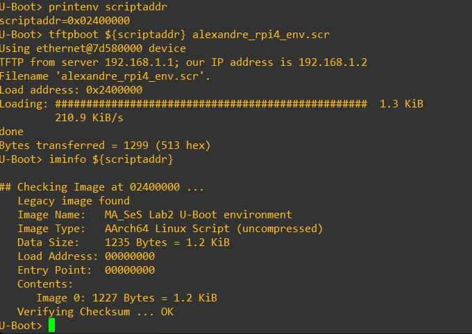

The output identified:

```text
Image Type:   AArch64 Linux Script (uncompressed)
```

and reported:

```text
Verifying Checksum ... OK
```

This proves that U-Boot recognized the object at `${scriptaddr}` as a valid script image and that its integrity check passed.

## Testing recovery from a default environment

The important test was not simply whether the script could run on an already configured system.

The lab required proving that it could rebuild the complete configuration from a stock/default U-Boot environment.

The environment was deliberately erased with:

```text
env default -a -f
saveenv
```

`env default -a -f` resets all environment variables to their compiled defaults.

The `saveenv` immediately afterwards makes this reset persistent, ensuring that the following test does not accidentally rely on the previously saved custom environment.

At that point, only the minimum networking configuration needed for TFTP was restored manually:

```text
setenv ipaddr 192.168.1.2
setenv serverip 192.168.1.1
setenv netmask 255.255.255.0
```

The script was downloaded again and executed with:

```text
tftpboot ${scriptaddr} alexandre_rpi4_env.scr
source ${scriptaddr}
```

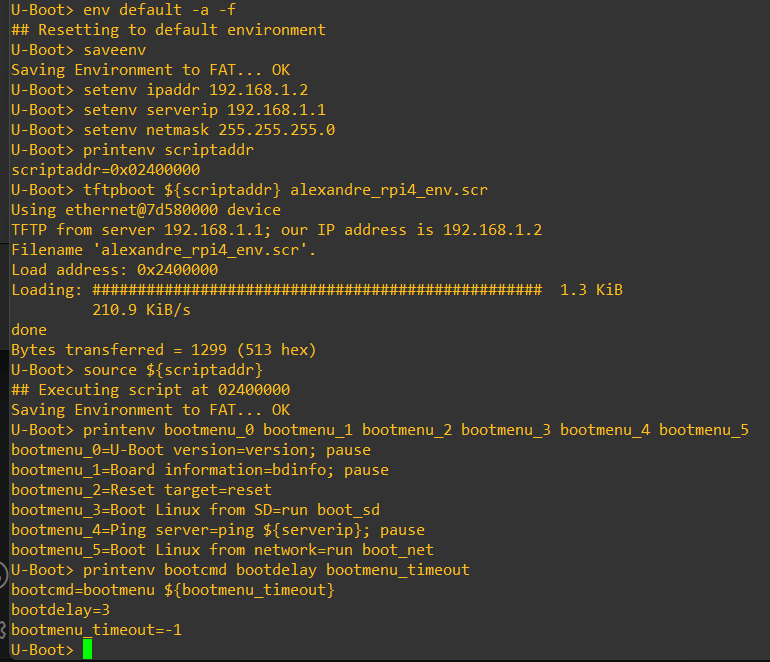

After execution, the expected variables had returned:

```text
bootdelay=3
bootmenu_timeout=-1
bootcmd=bootmenu ${bootmenu_timeout}
```

as well as all six menu entries.

Because the script ends with:

```text
saveenv
```

the restored environment was persisted automatically.

After:

```text
reset
```

U-Boot loaded the environment from FAT successfully and displayed the complete menu again:

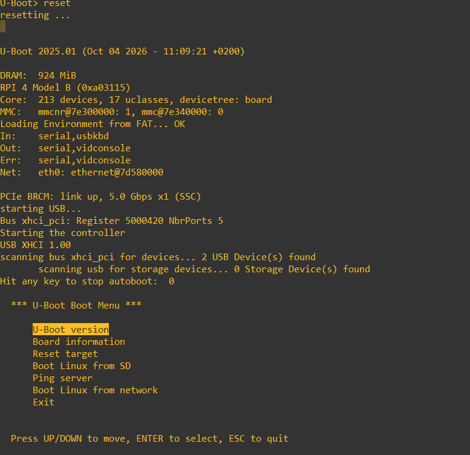

This validates the complete recovery process:

```text
default environment
        |
        | minimal network setup
        v
TFTP script image
        |
        | source
        v
complete environment in RAM
        |
        | saveenv
        v
uboot.env on SD card
        |
        | reset
        v
complete menu restored
```

## Integrating the script into Buildroot

The network test proved that the script worked, but the final goal was to make the solution reproducible as part of the Buildroot project.

The script image should not have to be generated manually after every build.

The requirements were:

- keep the source script under `board/raspberrypi`;
- generate the `.scr` automatically;
- use no absolute path tied to `/workspace/buildroot`;
- run the conversion before filesystem images are created;
- do not modify the existing Raspberry Pi `post-build.sh`;
- do not modify `genimage.cfg.in`;
- survive deletion of `output/images`;
- survive a complete `make clean`.

## Providing `mkimage` as a Buildroot host tool

The first manual script image had used the `mkimage` binary produced inside the U-Boot build tree.

A path such as:

```text
output/build/uboot-2025.01/tools/mkimage
```

is not suitable for a clean reproducible solution because the whole `output/build` tree can disappear after:

```sh
make clean
```

Buildroot provides a dedicated host package for the U-Boot tools.

The following option was therefore enabled:

```text
BR2_PACKAGE_HOST_UBOOT_TOOLS=y
```

This makes the host-side tool available through:

```text
${HOST_DIR}/bin/mkimage
```

In the concrete build directory this became:

```text
output/host/bin/mkimage
```

The important difference is not just the path.

Because the tool is now a declared Buildroot dependency, Buildroot knows that it must rebuild and install it after a clean build.

## Creating the conversion shell script

A new executable script was added:

```text
board/raspberrypi/alexandre_rpi4_env_image.sh
```

with the following contents:

```sh
#!/bin/sh

set -eu

SCRIPT_DIR="$(CDPATH= cd -- "$(dirname -- "$0")" && pwd)"

mkdir -p "${BINARIES_DIR}/rpi-firmware"

"${HOST_DIR}/bin/mkimage" \
    -A arm64 \
    -O linux \
    -T script \
    -C none \
    -n "MA_SeS Lab2 U-Boot environment" \
    -d "${SCRIPT_DIR}/alexandre_rpi4_env.cmd" \
    "${BINARIES_DIR}/rpi-firmware/alexandre_rpi4_env.scr"
```

This script deliberately avoids hard-coded absolute paths.

It uses Buildroot-provided variables:

```text
HOST_DIR
    location of host-side tools

BINARIES_DIR
    location where Buildroot assembles generated images
```

The script determines the directory containing itself through:

```sh
SCRIPT_DIR="$(CDPATH= cd -- "$(dirname -- "$0")" && pwd)"
```

so the `.cmd` source can be referenced relative to the board files rather than through `/workspace/buildroot/...`.

`set -e` also makes the script stop with a non-zero status if an important command fails, allowing Buildroot to detect the failure rather than silently continuing with a missing script image.

## Running the conversion before filesystem creation

Buildroot provides a system configuration option:

```text
BR2_ROOTFS_POST_BUILD_SCRIPT
```

Its help explains that these scripts run after the build is prepared but **before Buildroot creates the filesystem images**.

The existing Raspberry Pi post-build script was preserved and the new script was appended:

```text
BR2_ROOTFS_POST_BUILD_SCRIPT="board/raspberrypi4-64/post-build.sh board/raspberrypi/alexandre_rpi4_env_image.sh"
```

This is important because replacing the existing Raspberry Pi script could remove board-specific setup that Buildroot already expects.

The final sequence becomes:

```text
Buildroot packages / target tree
        |
        v
existing Raspberry Pi post-build.sh
        |
        v
alexandre_rpi4_env_image.sh
        |
        | mkimage
        v
output/images/rpi-firmware/alexandre_rpi4_env.scr
        |
        v
filesystem/image generation
```

## Why the script is placed in `rpi-firmware`

The generated image is written to:

```text
${BINARIES_DIR}/rpi-firmware/alexandre_rpi4_env.scr
```

The Raspberry Pi image-generation flow already copies the contents of:

```text
output/images/rpi-firmware/
```

into the FAT boot filesystem.

This means `genimage.cfg.in` does not need to be modified just to add one more boot-partition file.

The arrangement is therefore:

```text
board/raspberrypi/alexandre_rpi4_env.cmd
        |
        | post-build conversion
        v
output/images/rpi-firmware/alexandre_rpi4_env.scr
        |
        | existing image-generation flow
        v
boot.vfat
        |
        v
SD-card FAT partition
```

## Proving the solution survives `make clean`

A complete clean build was performed with:

```sh
make clean
make -j4
```

This is a strong reproducibility test because the generated host tools, U-Boot build tree and image output all have to be recreated.

After the build, all required generated objects existed again:

```text
output/host/bin/mkimage
output/images/rpi-firmware/alexandre_rpi4_env.scr
output/images/boot.vfat
output/images/sdcard.img
```

The generated script was also validated with:

```sh
output/host/bin/mkimage \
    -l output/images/rpi-firmware/alexandre_rpi4_env.scr
```

and identified as:

```text
AArch64 Linux Script (uncompressed)
```

Finally, the contents of `boot.vfat` were inspected directly with Buildroot's host `mdir`:

```sh
output/host/bin/mdir -i output/images/boot.vfat :: | grep -i alexandre
```

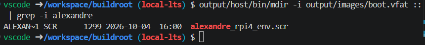

The entry:

```text
ALEXAN~1 SCR ... alexandre_rpi4_env.scr
```

proves that the generated script image is physically present in the FAT filesystem image, not merely left somewhere in the Buildroot output directory.

## Final recovery test from the SD card

The freshly generated `sdcard.img` was flashed to the SD card.

On the first boot, U-Boot reported:

```text
Unable to read "uboot.env" from mmc0:1
```

This is expected for a fresh image.

The Buildroot image contains the script image, but it does not contain a previously generated runtime `uboot.env`.

This demonstrates an important distinction:

```text
alexandre_rpi4_env.scr
    reproducible configuration script included in the image

uboot.env
    runtime persistent environment created by saveenv
```

The U-Boot environment was explicitly reset once more:

```text
env default -a -f
saveenv
```

The script address was then checked:

```text
printenv scriptaddr
```

and the script was loaded **from the SD card itself**:

```text
fatload mmc 0:1 ${scriptaddr} alexandre_rpi4_env.scr
```

The image was validated with:

```text
iminfo ${scriptaddr}
```

and executed using:

```text
source ${scriptaddr}
```

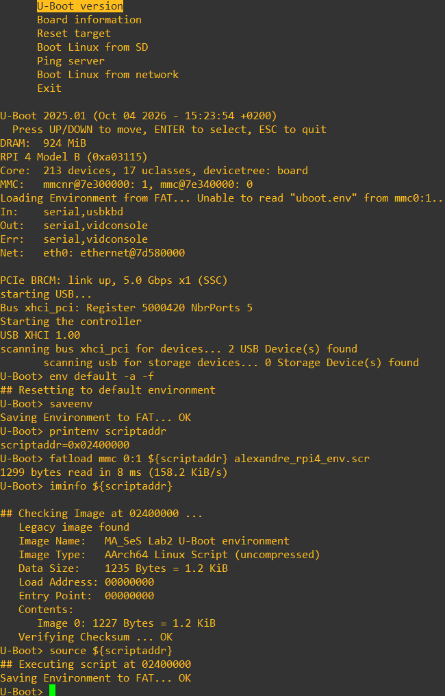

The image checksum passed and the script executed successfully.

Because the script ends with `saveenv`, a new `uboot.env` was created on the FAT partition.

After:

```text
reset
```

U-Boot reported:

```text
Loading Environment from FAT... OK
```

and the complete boot menu was restored:

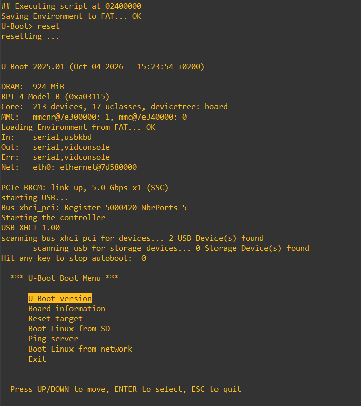

This final test proves that the complete configuration is reproducible from the project source alone.

The system no longer depends on manually entering dozens of environment commands or manually generating a script image.

## Final reproducible configuration path

The complete process can be summarized as:

```text
Git-controlled source files
|
├── alexandre_rpi4_env.cmd
├── alexandre_rpi4_env_image.sh
├── alexandre_rpi4_uboot.fragment
└── alexandre_rpi4_64_defconfig
        |
        v
     Buildroot
        |
        +--> builds host mkimage
        |
        +--> builds U-Boot with config fragment
        |
        +--> runs env-image post-build script
        |
        v
output/images/rpi-firmware/alexandre_rpi4_env.scr
        |
        v
boot.vfat
        |
        v
sdcard.img
        |
        | flash
        v
Raspberry Pi
        |
        | fatload + source
        v
persistent uboot.env
        |
        v
complete boot menu
```

This is significantly more robust than manually configuring each flashed SD card.

## Oral-exam notes

A U-Boot script source and a U-Boot script image are not the same thing.

The `.cmd` file is editable text containing U-Boot commands.

The `.scr` file is a generated U-Boot image containing that script plus image metadata/integrity information and is suitable for commands such as `iminfo` and `source`.

`scriptaddr` is the RAM location used to load the script image before executing it.

`source ${scriptaddr}` executes the commands stored in the script image.

The script itself calls `saveenv`, so after execution the resulting environment becomes persistent in `uboot.env`.

The generated `.scr` should **not** be treated as the primary source file. The reproducible sources are the `.cmd`, the conversion shell script and the Buildroot configuration. Buildroot can regenerate the `.scr`.

`${HOST_DIR}` and `${BINARIES_DIR}` are preferable to absolute paths because they are supplied by Buildroot and keep the integration independent of where the Buildroot tree is located.

Placing the generated script in `${BINARIES_DIR}/rpi-firmware` makes it automatically enter the Raspberry Pi FAT boot filesystem through the existing image-generation flow.

The strongest validation was the complete `make clean` test followed by a fresh SD image and recovery from a default U-Boot environment using only the script stored on the SD card.


## 9. Final Buildroot changes and patches

## 10. Key concepts / oral exam notes